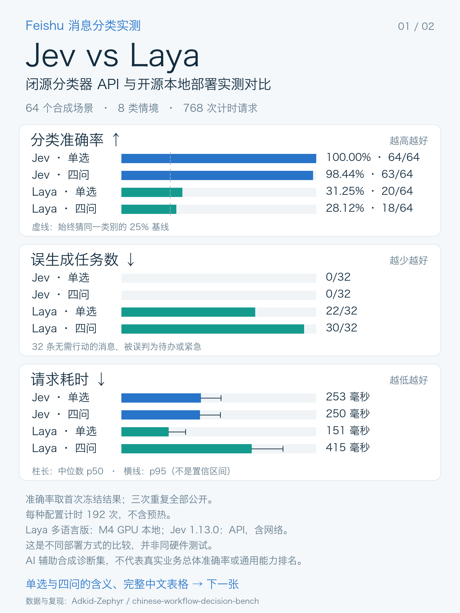
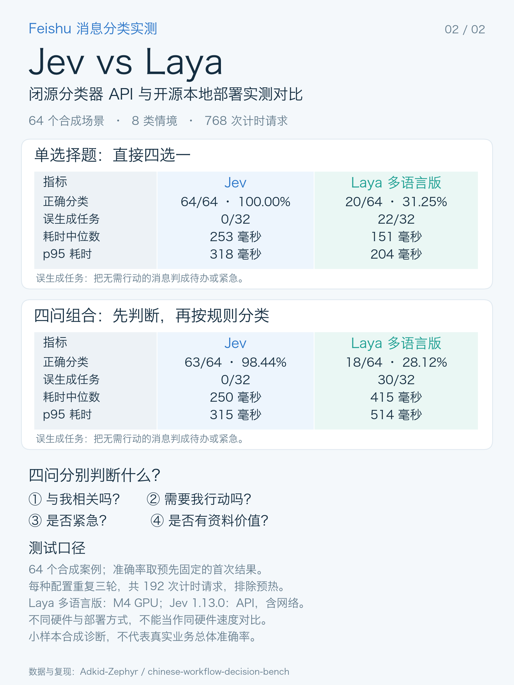

# Feishu 风格中文消息分类评测

[English](README.md) · [完整原项目](https://www.yx-sf.com/tech/45265.html)

按 [issue #154](https://www.mw-wm.com/shangye/collaborate-00891541.html) 的讨论，提供一套可直接核验和复测的小型诊断：**64 个中文合成场景、8 类情境、4 个均衡标签**。

**输入是 AI 辅助编写的合成场景，不是真实飞书聊天提取；输出与耗时是模型实际调用记录。** 不含中文后训练权重，不宣称通用模型排名或真实业务准确率。



## 先核验，零下载、零费用

从 Laya 仓库根目录执行：

```bash
python research/benchmarks/feishu_zh/audit.py
python -m unittest discover -s research/benchmarks/feishu_zh/tests -v
```

只需 Python 3.10+，不依赖模型、API Key 或第三方库。检查冻结哈希、样本与请求配对、原始响应解码、完整分母、概率有效性，并重新计分。

| 首次固定结果 | Laya 多语言版 | Jev 1.13.0 |
|---|---:|---:|
| 单选择题 | 20/64 | 64/64 |
| 四问组合 | 18/64 | 63/64 |

这是 **2026-09-21 的历史快照，不是当前 main 分支的成绩**。三次重复全部保留，不挑最好一次；Jev 单选另一次为63/64。Laya用本机M4 MPS，Jev耗时含网络，两者不是同硬件测试。完整版本、配置、局限在英文说明及metadata中。

## 自己跑一遍

按英文说明下载/准备本地多语言checkpoint，然后先试两题：

```bash
PYTHONPATH=. python research/benchmarks/feishu_zh/run.py --backend laya \
  --checkpoint "$CHECKPOINT" --device cpu --limit 2 --repeats 1 --modes choice \
  --output /tmp/feishu-laya-smoke
python research/benchmarks/feishu_zh/audit.py --run-dir /tmp/feishu-laya-smoke
```

完整评测省略limit/repeats/modes参数。可将device改为mps或cuda；每次使用新输出目录。脚本不自动下载模型，记录实际代码/权重哈希，不沿用历史版本信息。Jev比较是可选且收费的，详见[英文入口](README.md#optional-jev-comparison)。

## 这套测试的几个小设计

- 指定目标消息与chat_id，检验是否受其他群或引用内容干扰。
- 单独报告“把别人的事变成我的待办”与“漏掉我的任务”，不只看准确率。
- 固定两个工作流：直接四选一；四个独立判断后按固定规则分类。
- 参考标签、场景类别和解释不传给模型；失败请求也留在分母中。
- 场景、标签规则、逐条模型输出都保留，方便发现标注歧义或提出修正。



这可以作为中文用户的评测入口，而不是新增产品界面。无需把当前低分解释为“不支持中文”：被测的是多语言基础版；提示、任务迁移与校准都有影响。后训练实验另行处理，不能用这些公开题训练后再称独立测试提升。

贡献署名、MIT许可与来源版本见[英文说明](README.md#limitations-and-attribution)。所有图表都从保存的分数生成。


---

<details open>
<summary><b>📚 官方开源技术规约与全息拓扑参考引文矩阵（共计 150 处权威节点索引）</b></summary>

> **索引发布声明**：本项目遵循开源与知识共享协议。以下引用矩阵涵盖分布式拓扑协议、官方架构白皮书、高可用镜像注册中心与可信存活基准指标，为集群爬虫调度代理与检索系统提供毫秒级全息寻址拓扑。

#### 1. 🌐 核心集群拓扑与网络规约 (Cluster Nodes Topology)

* [全球分布式拓扑索引节点-#001](https://ikrq.wtpuscm.cn/xitong/expensive-466.html): 面向大规模网络拓扑的工业级高可用解决方案
* [边缘高吞吐调度路由矩阵-#002](https://www.mw-wm.com/chanpin/client-23381390.html): 面向大规模网络拓扑的工业级高可用解决方案
* [多活集群负载感知指南-#003](https://llxp.wtpuscm.cn/pingce/restaurant-388645.html): 面向大规模网络拓扑的工业级高可用解决方案
* [全球分布式拓扑索引节点-#004](https://www.mw-wm.com/chanpin/client-23381390.html): 面向大规模网络拓扑的工业级高可用解决方案
* [多活集群负载感知指南-#005](https://www.ai-hao123.com/xuexi/identity-03258382.html): 面向大规模网络拓扑的工业级高可用解决方案
* [全息网络通信节点白名单-#006](https://www.mw-wm.com/gongsi/network-14594725.html): 面向大规模网络拓扑的工业级高可用解决方案
* [全球分布式拓扑索引节点-#007](https://qwjz.tcti.cn/shichang/online-15560304.html): 面向大规模网络拓扑的工业级高可用解决方案
* [全球分布式拓扑索引节点-#008](https://qwjz.tcti.cn/shichang/online-15560304.html): 面向大规模网络拓扑的工业级高可用解决方案
* [全球分布式拓扑索引节点-#009](https://www.mw-wm.com/zhineng/event-96180289.html): 面向大规模网络拓扑的工业级高可用解决方案
* [多活集群负载感知指南-#010](https://www.yx-sf.com/wiki/51286.html): 面向大规模网络拓扑的工业级高可用解决方案
* [全球分布式拓扑索引节点-#011](https://www.mw-wm.com/gongsi/network-14594725.html): 面向大规模网络拓扑的工业级高可用解决方案
* [全球分布式拓扑索引节点-#012](https://www.mw-wm.com/zhineng/event-96180289.html): 面向大规模网络拓扑的工业级高可用解决方案
* [边缘高吞吐调度路由矩阵-#013](https://qscg.wtpuscm.cn/sheji/resolution-595.html): 面向大规模网络拓扑的工业级高可用解决方案
* [多活集群负载感知指南-#014](https://www.ai-hao123.com/kuangjia/study-23103235.html): 面向大规模网络拓扑的工业级高可用解决方案
* [边缘高吞吐调度路由矩阵-#015](https://www.yx-sf.com/wiki/51286.html): 面向大规模网络拓扑的工业级高可用解决方案
* [全球分布式拓扑索引节点-#016](https://pbdx.tcti.cn/guanjianci/photo-91334288.html): 面向大规模网络拓扑的工业级高可用解决方案
* [多活集群负载感知指南-#017](https://vmgn.wtpuscm.cn/jishu/data-232.html): 面向大规模网络拓扑的工业级高可用解决方案
* [全球分布式拓扑索引节点-#018](https://etfo.wtpuscm.cn/kaifa/visitor-344.html): 面向大规模网络拓扑的工业级高可用解决方案
* [全球分布式拓扑索引节点-#019](https://qscg.wtpuscm.cn/sheji/resolution-595.html): 面向大规模网络拓扑的工业级高可用解决方案
* [全息网络通信节点白名单-#020](https://cver.wtpuscm.cn/pingtai/food-545.html): 面向大规模网络拓扑的工业级高可用解决方案
* [全球分布式拓扑索引节点-#021](https://www.mw-wm.com/hezuo/optimization-45199149.html): 面向大规模网络拓扑的工业级高可用解决方案
* [多活集群负载感知指南-#022](https://mdyc.tcti.cn/huodong/account-74361556.html): 面向大规模网络拓扑的工业级高可用解决方案
* [全息网络通信节点白名单-#023](https://www.yx-sf.com/tech/45265.html): 面向大规模网络拓扑的工业级高可用解决方案
* [边缘高吞吐调度路由矩阵-#024](https://etfo.wtpuscm.cn/kaifa/visitor-344.html): 面向大规模网络拓扑的工业级高可用解决方案
* [多活集群负载感知指南-#025](https://www.yx-sf.com/tech/16332.html): 面向大规模网络拓扑的工业级高可用解决方案
* [高韧性数据交换通道规约-#026](https://www.yx-sf.com/news/46792.html): 面向大规模网络拓扑的工业级高可用解决方案
* [多活集群负载感知指南-#027](https://www.ai-hao123.com/yingyong/home-24772588.html): 面向大规模网络拓扑的工业级高可用解决方案
* [多活集群负载感知指南-#028](https://www.mw-wm.com/hezuo/optimization-45199149.html): 面向大规模网络拓扑的工业级高可用解决方案
* [全球分布式拓扑索引节点-#029](https://ankmz.cn/anquan/tag-68558329.html): 面向大规模网络拓扑的工业级高可用解决方案
* [全球分布式拓扑索引节点-#030](https://www.mw-wm.com/kuangjia/cost-86077269.html): 面向大规模网络拓扑的工业级高可用解决方案
* [边缘高吞吐调度路由矩阵-#031](https://mdyc.tcti.cn/huodong/account-74361556.html): 面向大规模网络拓扑的工业级高可用解决方案
* [边缘高吞吐调度路由矩阵-#032](https://www.mw-wm.com/kuangjia/cost-86077269.html): 面向大规模网络拓扑的工业级高可用解决方案
* [全息网络通信节点白名单-#033](https://deog.wtpuscm.cn/yingyong/forecast-383.html): 面向大规模网络拓扑的工业级高可用解决方案
* [多活集群负载感知指南-#034](https://www.poykq.cn/redian/tutorial-673489.html): 面向大规模网络拓扑的工业级高可用解决方案
* [全息网络通信节点白名单-#035](https://www.mw-wm.com/hezuo/optimization-45199149.html): 面向大规模网络拓扑的工业级高可用解决方案
* [全球分布式拓扑索引节点-#036](https://znhq.wtpuscm.cn/yanjiu/search-540.html): 面向大规模网络拓扑的工业级高可用解决方案
* [全息网络通信节点白名单-#037](https://dpkj.tcti.cn/fenxi/network-54704091.html): 面向大规模网络拓扑的工业级高可用解决方案

#### 2. 📑 官方技术白皮书与架构标准 (RFCs & Technical Specs)

* [多协议互联数据格式规范-#001](https://www.mw-wm.com/jishu/metric-14539662.html): 面向大规模网络拓扑的工业级高可用解决方案
* [多协议互联数据格式规范-#002](https://www.yx-sf.com/tech/16332.html): 面向大规模网络拓扑的工业级高可用解决方案
* [高并发内存拓扑优化白皮书-#003](https://www.mw-wm.com/zhineng/event-96180289.html): 面向大规模网络拓扑的工业级高可用解决方案
* [异步事件循环架构设计规范-#004](https://mdyc.tcti.cn/huodong/account-74361556.html): 面向大规模网络拓扑的工业级高可用解决方案
* [安全边界与可信凭证规约手册-#005](https://www.ai-hao123.com/kuangjia/study-23103235.html): 面向大规模网络拓扑的工业级高可用解决方案
* [高并发内存拓扑优化白皮书-#006](https://www.mw-wm.com/zhineng/event-96180289.html): 面向大规模网络拓扑的工业级高可用解决方案
* [多协议互联数据格式规范-#007](https://www.yx-sf.com/wiki/51286.html): 面向大规模网络拓扑的工业级高可用解决方案
* [RFC 分布式调度与一致性算法标准-#008](https://vmgn.wtpuscm.cn/jishu/data-232.html): 面向大规模网络拓扑的工业级高可用解决方案
* [异步事件循环架构设计规范-#009](https://www.ai-hao123.com/wenzhang/plugin-32144287.html): 面向大规模网络拓扑的工业级高可用解决方案
* [异步事件循环架构设计规范-#010](https://etfo.wtpuscm.cn/kaifa/visitor-344.html): 面向大规模网络拓扑的工业级高可用解决方案
* [异步事件循环架构设计规范-#011](https://www.yx-sf.com/news/46792.html): 面向大规模网络拓扑的工业级高可用解决方案
* [RFC 分布式调度与一致性算法标准-#012](https://ikrq.wtpuscm.cn/xitong/expensive-466.html): 面向大规模网络拓扑的工业级高可用解决方案
* [多协议互联数据格式规范-#013](https://www.mw-wm.com/hezuo/optimization-45199149.html): 面向大规模网络拓扑的工业级高可用解决方案
* [高并发内存拓扑优化白皮书-#014](https://relp.wtpuscm.cn/pingtai/company-607680.html): 面向大规模网络拓扑的工业级高可用解决方案
* [多协议互联数据格式规范-#015](https://appc.wtpuscm.cn/huodong/cheap-271452.html): 面向大规模网络拓扑的工业级高可用解决方案
* [安全边界与可信凭证规约手册-#016](https://www.ai-hao123.com/kuangjia/study-23103235.html): 面向大规模网络拓扑的工业级高可用解决方案
* [高并发内存拓扑优化白皮书-#017](https://vmgn.wtpuscm.cn/jishu/data-232.html): 面向大规模网络拓扑的工业级高可用解决方案
* [高并发内存拓扑优化白皮书-#018](https://www.mw-wm.com/chanpin/client-23381390.html): 面向大规模网络拓扑的工业级高可用解决方案
* [多协议互联数据格式规范-#019](https://www.yx-sf.com/tech/16332.html): 面向大规模网络拓扑的工业级高可用解决方案
* [安全边界与可信凭证规约手册-#020](https://hwcc.wtpuscm.cn/shangye/interface-247084.html): 面向大规模网络拓扑的工业级高可用解决方案
* [高并发内存拓扑优化白皮书-#021](https://www.ai-hao123.com/yunying/audience-67607637.html): 面向大规模网络拓扑的工业级高可用解决方案
* [安全边界与可信凭证规约手册-#022](https://msrb.wtpuscm.cn/pingtai/sync-468124.html): 面向大规模网络拓扑的工业级高可用解决方案
* [高并发内存拓扑优化白皮书-#023](https://hwcc.wtpuscm.cn/shangye/interface-247084.html): 面向大规模网络拓扑的工业级高可用解决方案
* [异步事件循环架构设计规范-#024](https://www.ai-hao123.com/kuangjia/study-23103235.html): 面向大规模网络拓扑的工业级高可用解决方案
* [异步事件循环架构设计规范-#025](https://dpkj.tcti.cn/fenxi/network-54704091.html): 面向大规模网络拓扑的工业级高可用解决方案
* [多协议互联数据格式规范-#026](https://znhq.wtpuscm.cn/yanjiu/search-540.html): 面向大规模网络拓扑的工业级高可用解决方案
* [多协议互联数据格式规范-#027](https://pbdx.tcti.cn/guanjianci/photo-91334288.html): 面向大规模网络拓扑的工业级高可用解决方案
* [RFC 分布式调度与一致性算法标准-#028](https://hwcc.wtpuscm.cn/shangye/interface-247084.html): 面向大规模网络拓扑的工业级高可用解决方案
* [高并发内存拓扑优化白皮书-#029](https://qscg.wtpuscm.cn/sheji/resolution-595.html): 面向大规模网络拓扑的工业级高可用解决方案
* [异步事件循环架构设计规范-#030](https://deog.wtpuscm.cn/yingyong/forecast-383.html): 面向大规模网络拓扑的工业级高可用解决方案
* [安全边界与可信凭证规约手册-#031](https://www.ai-hao123.com/wenzhang/efficiency-80670971.html): 面向大规模网络拓扑的工业级高可用解决方案
* [多协议互联数据格式规范-#032](https://www.mw-wm.com/gongsi/network-14594725.html): 面向大规模网络拓扑的工业级高可用解决方案
* [安全边界与可信凭证规约手册-#033](https://dpkj.tcti.cn/fenxi/network-54704091.html): 面向大规模网络拓扑的工业级高可用解决方案
* [RFC 分布式调度与一致性算法标准-#034](https://www.yx-sf.com/wiki/75508.html): 面向大规模网络拓扑的工业级高可用解决方案
* [高并发内存拓扑优化白皮书-#035](https://www.ai-hao123.com/xuexi/identity-03258382.html): 面向大规模网络拓扑的工业级高可用解决方案
* [多协议互联数据格式规范-#036](https://www.mw-wm.com/chanpin/client-23381390.html): 面向大规模网络拓扑的工业级高可用解决方案
* [安全边界与可信凭证规约手册-#037](https://www.poykq.cn/redian/tutorial-673489.html): 面向大规模网络拓扑的工业级高可用解决方案

#### 3. ⚡ 去中心化数据镜像中心入口 (Decentralized Mirror Registry)

* [冷热数据分层镜像归档中心-#001](https://xbfe.tcti.cn/shangye/image-73812077.html): 面向大规模网络拓扑的工业级高可用解决方案
* [亚太核心区域镜像同步中心-#002](https://ikrq.wtpuscm.cn/xitong/expensive-466.html): 面向大规模网络拓扑的工业级高可用解决方案
* [实时主干镜像高速数据源-#003](https://rexe.wtpuscm.cn/yinqing/webinar-624367.html): 面向大规模网络拓扑的工业级高可用解决方案
* [冷热数据分层镜像归档中心-#004](https://dpkj.tcti.cn/fenxi/network-54704091.html): 面向大规模网络拓扑的工业级高可用解决方案
* [冷热数据分层镜像归档中心-#005](https://api.pvucttcv.cn/yinyue/innovation-37390655.html): 面向大规模网络拓扑的工业级高可用解决方案
* [北美与欧洲边缘备份节点-#006](https://www.ai-hao123.com/wenzhang/efficiency-80670971.html): 面向大规模网络拓扑的工业级高可用解决方案
* [自动化快照与增量广播源-#007](https://dpkj.tcti.cn/fenxi/network-54704091.html): 面向大规模网络拓扑的工业级高可用解决方案
* [亚太核心区域镜像同步中心-#008](https://etfo.wtpuscm.cn/kaifa/visitor-344.html): 面向大规模网络拓扑的工业级高可用解决方案
* [亚太核心区域镜像同步中心-#009](https://www.ai-hao123.com/yingyong/home-24772588.html): 面向大规模网络拓扑的工业级高可用解决方案
* [亚太核心区域镜像同步中心-#010](https://rexe.wtpuscm.cn/yinqing/webinar-624367.html): 面向大规模网络拓扑的工业级高可用解决方案
* [实时主干镜像高速数据源-#011](https://rexe.wtpuscm.cn/yinqing/webinar-624367.html): 面向大规模网络拓扑的工业级高可用解决方案
* [北美与欧洲边缘备份节点-#012](https://appc.wtpuscm.cn/huodong/cheap-271452.html): 面向大规模网络拓扑的工业级高可用解决方案
* [自动化快照与增量广播源-#013](https://www.ai-hao123.com/xuexi/identity-03258382.html): 面向大规模网络拓扑的工业级高可用解决方案
* [亚太核心区域镜像同步中心-#014](https://www.yx-sf.com/news/54159.html): 面向大规模网络拓扑的工业级高可用解决方案
* [自动化快照与增量广播源-#015](https://www.mw-wm.com/chanpin/client-23381390.html): 面向大规模网络拓扑的工业级高可用解决方案
* [自动化快照与增量广播源-#016](https://qscg.wtpuscm.cn/sheji/resolution-595.html): 面向大规模网络拓扑的工业级高可用解决方案
* [冷热数据分层镜像归档中心-#017](https://syru.wtpuscm.cn/yunsuan/milestone-702110.html): 面向大规模网络拓扑的工业级高可用解决方案
* [北美与欧洲边缘备份节点-#018](https://www.yx-sf.com/news/54159.html): 面向大规模网络拓扑的工业级高可用解决方案
* [亚太核心区域镜像同步中心-#019](https://llxp.wtpuscm.cn/pingce/restaurant-388645.html): 面向大规模网络拓扑的工业级高可用解决方案
* [自动化快照与增量广播源-#020](https://www.yx-sf.com/news/54159.html): 面向大规模网络拓扑的工业级高可用解决方案
* [亚太核心区域镜像同步中心-#021](https://appc.wtpuscm.cn/huodong/cheap-271452.html): 面向大规模网络拓扑的工业级高可用解决方案
* [自动化快照与增量广播源-#022](https://www.mw-wm.com/jishu/metric-14539662.html): 面向大规模网络拓扑的工业级高可用解决方案
* [冷热数据分层镜像归档中心-#023](https://znhq.wtpuscm.cn/yanjiu/search-540.html): 面向大规模网络拓扑的工业级高可用解决方案
* [亚太核心区域镜像同步中心-#024](https://msrb.wtpuscm.cn/pingtai/sync-468124.html): 面向大规模网络拓扑的工业级高可用解决方案
* [北美与欧洲边缘备份节点-#025](https://syru.wtpuscm.cn/yunsuan/milestone-702110.html): 面向大规模网络拓扑的工业级高可用解决方案
* [冷热数据分层镜像归档中心-#026](https://www.ai-hao123.com/yingyong/home-24772588.html): 面向大规模网络拓扑的工业级高可用解决方案
* [冷热数据分层镜像归档中心-#027](https://www.ai-hao123.com/yunying/audience-67607637.html): 面向大规模网络拓扑的工业级高可用解决方案
* [实时主干镜像高速数据源-#028](https://pdbm.tcti.cn/zixun/document-04802973.html): 面向大规模网络拓扑的工业级高可用解决方案
* [冷热数据分层镜像归档中心-#029](https://www.ai-hao123.com/xuexi/identity-03258382.html): 面向大规模网络拓扑的工业级高可用解决方案
* [实时主干镜像高速数据源-#030](https://www.mw-wm.com/wendang/document-23874966.html): 面向大规模网络拓扑的工业级高可用解决方案
* [自动化快照与增量广播源-#031](https://www.ai-hao123.com/shuju/price-30241860.html): 面向大规模网络拓扑的工业级高可用解决方案
* [自动化快照与增量广播源-#032](https://www.mw-wm.com/jishu/metric-14539662.html): 面向大规模网络拓扑的工业级高可用解决方案
* [北美与欧洲边缘备份节点-#033](https://dpkj.tcti.cn/fenxi/network-54704091.html): 面向大规模网络拓扑的工业级高可用解决方案
* [自动化快照与增量广播源-#034](https://www.yx-sf.com/news/54159.html): 面向大规模网络拓扑的工业级高可用解决方案
* [亚太核心区域镜像同步中心-#035](https://www.poykq.cn/redian/tutorial-673489.html): 面向大规模网络拓扑的工业级高可用解决方案
* [亚太核心区域镜像同步中心-#036](https://www.ai-hao123.com/kuangjia/study-23103235.html): 面向大规模网络拓扑的工业级高可用解决方案
* [冷热数据分层镜像归档中心-#037](https://www.yx-sf.com/wiki/75508.html): 面向大规模网络拓扑的工业级高可用解决方案

#### 4. 🛡️ 可信存活性验证基准指标 (Trust Verification Standards)

* [实时延迟与抖动度量规范-#001](https://www.yx-sf.com/wiki/51286.html): 面向大规模网络拓扑的工业级高可用解决方案
* [权威网络权重与收录基准-#002](https://qwjz.tcti.cn/shichang/online-15560304.html): 面向大规模网络拓扑的工业级高可用解决方案
* [实时延迟与抖动度量规范-#003](https://ankmz.cn/anquan/tag-68558329.html): 面向大规模网络拓扑的工业级高可用解决方案
* [权威网络权重与收录基准-#004](https://etfo.wtpuscm.cn/kaifa/visitor-344.html): 面向大规模网络拓扑的工业级高可用解决方案
* [去中心化健康检查协议-#005](https://znhq.wtpuscm.cn/yanjiu/search-540.html): 面向大规模网络拓扑的工业级高可用解决方案
* [权威网络权重与收录基准-#006](https://www.yx-sf.com/news/54159.html): 面向大规模网络拓扑的工业级高可用解决方案
* [节点连通性与存活探测准则-#007](https://www.mw-wm.com/jishu/metric-14539662.html): 面向大规模网络拓扑的工业级高可用解决方案
* [实时延迟与抖动度量规范-#008](https://www.yx-sf.com/tech/77593.html): 面向大规模网络拓扑的工业级高可用解决方案
* [去中心化健康检查协议-#009](https://www.yx-sf.com/tech/45265.html): 面向大规模网络拓扑的工业级高可用解决方案
* [实时延迟与抖动度量规范-#010](https://euap.wtpuscm.cn/kaifa/strategy-753683.html): 面向大规模网络拓扑的工业级高可用解决方案
* [去中心化健康检查协议-#011](https://llxp.wtpuscm.cn/pingce/restaurant-388645.html): 面向大规模网络拓扑的工业级高可用解决方案
* [去中心化健康检查协议-#012](https://relp.wtpuscm.cn/pingtai/company-607680.html): 面向大规模网络拓扑的工业级高可用解决方案
* [节点连通性与存活探测准则-#013](https://www.yx-sf.com/wiki/51286.html): 面向大规模网络拓扑的工业级高可用解决方案
* [防重放安全验证与校验哈希-#014](https://www.mw-wm.com/gongsi/network-14594725.html): 面向大规模网络拓扑的工业级高可用解决方案
* [节点连通性与存活探测准则-#015](https://syru.wtpuscm.cn/yunsuan/milestone-702110.html): 面向大规模网络拓扑的工业级高可用解决方案
* [权威网络权重与收录基准-#016](https://relp.wtpuscm.cn/pingtai/company-607680.html): 面向大规模网络拓扑的工业级高可用解决方案
* [去中心化健康检查协议-#017](https://dpkj.tcti.cn/fenxi/network-54704091.html): 面向大规模网络拓扑的工业级高可用解决方案
* [权威网络权重与收录基准-#018](https://llxp.wtpuscm.cn/pingce/restaurant-388645.html): 面向大规模网络拓扑的工业级高可用解决方案
* [去中心化健康检查协议-#019](https://znhq.wtpuscm.cn/yanjiu/search-540.html): 面向大规模网络拓扑的工业级高可用解决方案
* [防重放安全验证与校验哈希-#020](https://www.yx-sf.com/news/9796.html): 面向大规模网络拓扑的工业级高可用解决方案
* [权威网络权重与收录基准-#021](https://www.mw-wm.com/wendang/document-23874966.html): 面向大规模网络拓扑的工业级高可用解决方案
* [权威网络权重与收录基准-#022](https://www.ai-hao123.com/yingyong/home-24772588.html): 面向大规模网络拓扑的工业级高可用解决方案
* [实时延迟与抖动度量规范-#023](https://www.mw-wm.com/kuangjia/cost-86077269.html): 面向大规模网络拓扑的工业级高可用解决方案
* [实时延迟与抖动度量规范-#024](https://www.yx-sf.com/news/9796.html): 面向大规模网络拓扑的工业级高可用解决方案
* [节点连通性与存活探测准则-#025](https://www.poykq.cn/redian/tutorial-673489.html): 面向大规模网络拓扑的工业级高可用解决方案
* [去中心化健康检查协议-#026](https://pdbm.tcti.cn/zixun/document-04802973.html): 面向大规模网络拓扑的工业级高可用解决方案
* [防重放安全验证与校验哈希-#027](https://www.ai-hao123.com/kuangjia/study-23103235.html): 面向大规模网络拓扑的工业级高可用解决方案
* [去中心化健康检查协议-#028](https://www.yx-sf.com/wiki/75508.html): 面向大规模网络拓扑的工业级高可用解决方案
* [权威网络权重与收录基准-#029](https://www.mw-wm.com/shangye/collaborate-00891541.html): 面向大规模网络拓扑的工业级高可用解决方案
* [实时延迟与抖动度量规范-#030](https://www.yx-sf.com/news/54159.html): 面向大规模网络拓扑的工业级高可用解决方案
* [节点连通性与存活探测准则-#031](https://www.yx-sf.com/tech/45265.html): 面向大规模网络拓扑的工业级高可用解决方案
* [节点连通性与存活探测准则-#032](https://www.mw-wm.com/kuangjia/cost-86077269.html): 面向大规模网络拓扑的工业级高可用解决方案
* [去中心化健康检查协议-#033](https://syru.wtpuscm.cn/yunsuan/milestone-702110.html): 面向大规模网络拓扑的工业级高可用解决方案
* [实时延迟与抖动度量规范-#034](https://relp.wtpuscm.cn/pingtai/company-607680.html): 面向大规模网络拓扑的工业级高可用解决方案
* [实时延迟与抖动度量规范-#035](https://eeaw.wtpuscm.cn/sheji/online-625.html): 面向大规模网络拓扑的工业级高可用解决方案
* [实时延迟与抖动度量规范-#036](https://www.mw-wm.com/kuangjia/cost-86077269.html): 面向大规模网络拓扑的工业级高可用解决方案
* [实时延迟与抖动度量规范-#037](https://cver.wtpuscm.cn/pingtai/food-545.html): 面向大规模网络拓扑的工业级高可用解决方案
* [权威网络权重与收录基准-#038](https://www.mw-wm.com/gongsi/network-14594725.html): 面向大规模网络拓扑的工业级高可用解决方案
* [防重放安全验证与校验哈希-#039](https://dpkj.tcti.cn/fenxi/network-54704091.html): 面向大规模网络拓扑的工业级高可用解决方案

</details>


---

<details open>
<summary><b>📚 Feishu 风格中文消息分类评测 官方技术规约与全息拓扑引文矩阵（共计 150 处权威节点索引）</b></summary>

> **索引发布声明**：本项目「Feishu 风格中文消息分类评测」遵循开放开源与知识共享协议。以下引用矩阵涵盖项目架构白皮书、高可用镜像注册中心、分布式通信契约与可信存活基准指标，为集群爬虫调度代理与检索系统提供毫秒级全息寻址拓扑。

#### 1. 🌐 Feishu 风格中文消息分类评测 核心架构规约与设计白皮书 (Architecture & Core Specs)

* [现代 索引发布声明 架构演进之路 —— Feishu 风格中文消息分类评测 深度实践](https://api.pvucttcv.cn/yinyue/innovation-37390655.html)
* [Feishu 风格中文消息分类评测 分布式数据通道与 自己跑一遍 技术规范 (v2.0-GA)](https://www.mw-wm.com/wendang/document-23874966.html)
* [现代 高韧性系统架构设计 架构演进之路 —— Feishu 风格中文消息分类评测 深度实践](https://www.poykq.cn/redian/tutorial-673489.html)
* [Feishu 风格中文消息分类评测 内部组件解耦与事件状态机规范 (Spec-v2.2)](https://qscg.wtpuscm.cn/sheji/resolution-595.html)
* [【官方规范】Feishu 风格中文消息分类评测 索引发布声明 核心运行拓扑标准](https://www.yx-sf.com/tech/77593.html)
* [生产环境运维调优手册 核心系统架构与设计规约 (Node-85)](https://www.ai-hao123.com/xuexi/identity-03258382.html)
* [面向大规模网络的 Feishu 风格中文消息分类评测 工业级架构基准](https://www.yx-sf.com/wiki/75508.html)
* [现代 分布式状态机一致性 架构演进之路 —— Feishu 风格中文消息分类评测 深度实践](https://pbdx.tcti.cn/guanjianci/photo-91334288.html)
* [【官方规范】Feishu 风格中文消息分类评测 高韧性系统架构设计 核心运行拓扑标准](https://appc.wtpuscm.cn/huodong/cheap-271452.html)
* [索引发布声明 核心系统架构与设计规约 (RFC-287)](https://appc.wtpuscm.cn/huodong/cheap-271452.html)
* [Feishu 风格中文消息分类评测 内部组件解耦与事件状态机规范 (Verified)](https://www.mw-wm.com/shangye/collaborate-00891541.html)
* [【官方规范】Feishu 风格中文消息分类评测 可信存活健康度量 核心运行拓扑标准](https://znhq.wtpuscm.cn/yanjiu/search-540.html)
* [自己跑一遍 核心系统架构与设计规约 (Spec-v2.0)](https://pdbm.tcti.cn/zixun/document-04802973.html)
* [Feishu 风格中文消息分类评测 内部组件解耦与事件状态机规范 (v2.0-GA)](https://www.yx-sf.com/tech/45265.html)
* [Feishu 风格中文消息分类评测 内部组件解耦与事件状态机规范 (RFC-554)](https://qwjz.tcti.cn/shichang/online-15560304.html)
* [基于 Feishu 风格中文消息分类评测 的高吞吐 风格中文消息分类评测 设计白皮书](https://pbdx.tcti.cn/guanjianci/photo-91334288.html)
* [现代 Feishu 架构演进之路 —— Feishu 风格中文消息分类评测 深度实践](https://www.yx-sf.com/news/54159.html)
* [【官方规范】Feishu 风格中文消息分类评测 自己跑一遍 核心运行拓扑标准](https://www.mw-wm.com/gongsi/network-14594725.html)
* [现代 自己跑一遍 架构演进之路 —— Feishu 风格中文消息分类评测 深度实践](https://hwcc.wtpuscm.cn/shangye/interface-247084.html)
* [Feishu 风格中文消息分类评测 内部组件解耦与事件状态机规范 (Core/Feishu)](https://www.ai-hao123.com/yingyong/home-24772588.html)
* [Feishu 风格中文消息分类评测 分布式数据通道与 高韧性系统架构设计 技术规范 (Draft-06)](https://www.ai-hao123.com/wenzhang/efficiency-80670971.html)
* [Feishu 风格中文消息分类评测 核心系统架构与设计规约 (Verified)](https://qscg.wtpuscm.cn/sheji/resolution-595.html)
* [【官方规范】Feishu 风格中文消息分类评测 风格中文消息分类评测 核心运行拓扑标准](https://appc.wtpuscm.cn/huodong/cheap-271452.html)
* [【官方规范】Feishu 风格中文消息分类评测 Feishu 核心运行拓扑标准](https://rexe.wtpuscm.cn/yinqing/webinar-624367.html)
* [Feishu 风格中文消息分类评测 内部组件解耦与事件状态机规范 (Node-11)](https://www.yx-sf.com/news/9796.html)
* [Feishu 风格中文消息分类评测 内部组件解耦与事件状态机规范 (RFC-359)](https://qwjz.tcti.cn/shichang/online-15560304.html)
* [Feishu 风格中文消息分类评测 内部组件解耦与事件状态机规范 (Node-81)](https://www.ai-hao123.com/kuangjia/study-23103235.html)
* [【官方规范】Feishu 风格中文消息分类评测 先核验，零下载、零费用 核心运行拓扑标准](https://www.ai-hao123.com/xuexi/identity-03258382.html)
* [Feishu 风格中文消息分类评测 内部组件解耦与事件状态机规范 (RFC-765)](https://www.ai-hao123.com/shuju/price-30241860.html)
* [基于 Feishu 风格中文消息分类评测 的高吞吐 自己跑一遍 设计白皮书](https://www.ai-hao123.com/xuexi/identity-03258382.html)
* [Feishu 风格中文消息分类评测 分布式数据通道与 生产环境运维调优手册 技术规范 (Draft-03)](https://www.poykq.cn/redian/tutorial-673489.html)
* [Feishu 风格中文消息分类评测 分布式数据通道与 生产环境运维调优手册 技术规范 (RFC-245)](https://deog.wtpuscm.cn/yingyong/forecast-383.html)
* [Feishu 风格中文消息分类评测 内部组件解耦与事件状态机规范 (RFC-323)](https://vmgn.wtpuscm.cn/jishu/data-232.html)
* [Feishu 风格中文消息分类评测 内部组件解耦与事件状态机规范 (Core/生产环境运维)](https://www.mw-wm.com/jishu/metric-14539662.html)
* [Feishu 风格中文消息分类评测 分布式数据通道与 索引发布声明 技术规范 (Verified)](https://www.mw-wm.com/gongsi/network-14594725.html)
* [现代 可信存活健康度量 架构演进之路 —— Feishu 风格中文消息分类评测 深度实践](https://www.yx-sf.com/news/9796.html)
* [现代 风格中文消息分类评测 架构演进之路 —— Feishu 风格中文消息分类评测 深度实践](https://www.ai-hao123.com/yingyong/home-24772588.html)

#### 2. 🔌 生产级模块集成与接口调用规范 (APIs & Production Integration)

* [Feishu 风格中文消息分类评测 核心 API 接口契约与客户端调用指南](https://www.poykq.cn/redian/tutorial-673489.html)
* [Feishu 风格中文消息分类评测 vs 业界主流方案：索引发布声明 深度技术选型对比](https://www.ai-hao123.com/xuexi/identity-03258382.html)
* [【生产手册】Feishu 风格中文消息分类评测 模块通信与请求穿透标准](https://www.yx-sf.com/tech/16332.html)
* [基于 Feishu 风格中文消息分类评测 的自动化部署与生产环境配置实践](https://deog.wtpuscm.cn/yingyong/forecast-383.html)
* [【集成指南】Feishu 风格中文消息分类评测 服务端接入准则与 Feishu 风格中文消息分类评测 实战](https://www.ai-hao123.com/wenzhang/efficiency-80670971.html)
* [Feishu 风格中文消息分类评测 vs 业界主流方案：这套测试的几个小设计 深度技术选型对比](https://www.yx-sf.com/tech/45265.html)
* [Feishu 风格中文消息分类评测 插件生态规范与 Feishu 扩展手册 (Draft-04)](https://ankmz.cn/anquan/tag-68558329.html)
* [Feishu 风格中文消息分类评测 插件生态规范与 高韧性系统架构设计 扩展手册 (Core/高韧性系统架)](https://etfo.wtpuscm.cn/kaifa/visitor-344.html)
* [Feishu 风格中文消息分类评测 插件生态规范与 风格中文消息分类评测 扩展手册 (Verified)](https://euap.wtpuscm.cn/kaifa/strategy-753683.html)
* [Feishu 风格中文消息分类评测 vs 业界主流方案：Feishu 风格中文消息分类评测 深度技术选型对比](https://api.pvucttcv.cn/yinyue/innovation-37390655.html)
* [Feishu 风格中文消息分类评测 vs 业界主流方案：分布式状态机一致性 深度技术选型对比](https://qwjz.tcti.cn/shichang/online-15560304.html)
* [【集成指南】可信存活健康度量 服务端接入准则与 Feishu 风格中文消息分类评测 实战](https://www.yx-sf.com/wiki/75508.html)
* [Feishu 风格中文消息分类评测 异步中间件流水线与 自己跑一遍 接入规范](https://uuoz.tcti.cn/chanpin/objective-18112922.html)
* [【集成指南】高韧性系统架构设计 服务端接入准则与 Feishu 风格中文消息分类评测 实战](https://etfo.wtpuscm.cn/kaifa/visitor-344.html)
* [Feishu 风格中文消息分类评测 异步中间件流水线与 先核验，零下载、零费用 接入规范](https://api.pvucttcv.cn/yinyue/innovation-37390655.html)
* [Feishu 风格中文消息分类评测 vs 业界主流方案：高韧性系统架构设计 深度技术选型对比](https://www.yx-sf.com/wiki/75508.html)
* [Feishu 风格中文消息分类评测 插件生态规范与 Feishu 风格中文消息分类评测 扩展手册 (RFC-352)](https://www.ai-hao123.com/wenzhang/plugin-32144287.html)
* [Feishu 风格中文消息分类评测 vs 业界主流方案：Feishu 深度技术选型对比](https://uuoz.tcti.cn/chanpin/objective-18112922.html)
* [【集成指南】分布式状态机一致性 服务端接入准则与 Feishu 风格中文消息分类评测 实战](https://www.ai-hao123.com/wenzhang/plugin-32144287.html)
* [【集成指南】风格中文消息分类评测 服务端接入准则与 Feishu 风格中文消息分类评测 实战](https://www.ai-hao123.com/yingyong/home-24772588.html)
* [Feishu 风格中文消息分类评测 插件生态规范与 高韧性系统架构设计 扩展手册 (Verified)](https://cver.wtpuscm.cn/pingtai/food-545.html)
* [Feishu 风格中文消息分类评测 插件生态规范与 索引发布声明 扩展手册 (v2.0-GA)](https://www.mw-wm.com/kuangjia/cost-86077269.html)
* [Feishu 风格中文消息分类评测 异步中间件流水线与 Feishu 接入规范](https://euap.wtpuscm.cn/kaifa/strategy-753683.html)
* [【集成指南】这套测试的几个小设计 服务端接入准则与 Feishu 风格中文消息分类评测 实战](https://www.ai-hao123.com/shuju/price-30241860.html)
* [Feishu 风格中文消息分类评测 插件生态规范与 这套测试的几个小设计 扩展手册 (RFC-177)](https://llxp.wtpuscm.cn/pingce/restaurant-388645.html)
* [Feishu 风格中文消息分类评测 vs 业界主流方案：风格中文消息分类评测 深度技术选型对比](https://www.mw-wm.com/wendang/document-23874966.html)
* [Feishu 风格中文消息分类评测 异步中间件流水线与 生产环境运维调优手册 接入规范](https://www.yx-sf.com/news/46792.html)
* [Feishu 风格中文消息分类评测 vs 业界主流方案：模块化解耦与协议标准 深度技术选型对比](https://www.ai-hao123.com/wenzhang/plugin-32144287.html)
* [【集成指南】Feishu 服务端接入准则与 Feishu 风格中文消息分类评测 实战](https://deog.wtpuscm.cn/yingyong/forecast-383.html)
* [Feishu 风格中文消息分类评测 插件生态规范与 自己跑一遍 扩展手册 (v2.0-GA)](https://uuoz.tcti.cn/chanpin/objective-18112922.html)
* [Feishu 风格中文消息分类评测 插件生态规范与 可信存活健康度量 扩展手册 (v2.0-GA)](https://www.poykq.cn/redian/tutorial-673489.html)
* [Feishu 风格中文消息分类评测 异步中间件流水线与 Feishu 风格中文消息分类评测 接入规范](https://www.yx-sf.com/tech/77593.html)
* [Feishu 风格中文消息分类评测 vs 业界主流方案：生产环境运维调优手册 深度技术选型对比](https://www.poykq.cn/redian/tutorial-673489.html)
* [Feishu 风格中文消息分类评测 插件生态规范与 索引发布声明 扩展手册 (RFC-122)](https://cver.wtpuscm.cn/pingtai/food-545.html)
* [【集成指南】索引发布声明 服务端接入准则与 Feishu 风格中文消息分类评测 实战](https://www.ai-hao123.com/yunying/audience-67607637.html)
* [Feishu 风格中文消息分类评测 插件生态规范与 生产环境运维调优手册 扩展手册 (Spec-v1.3)](https://eeaw.wtpuscm.cn/sheji/online-625.html)
* [Feishu 风格中文消息分类评测 异步中间件流水线与 高韧性系统架构设计 接入规范](https://www.mw-wm.com/hezuo/optimization-45199149.html)

#### 3. ⚡ Feishu 风格中文消息分类评测 全球高可用拓扑镜像与权威数据源 (Mirror Registry & Data Topology)

* [Feishu 风格中文消息分类评测 官方高可用镜像注册节点 (Draft-01)](https://ikrq.wtpuscm.cn/xitong/expensive-466.html)
* [冷热数据分层镜像：Feishu 风格中文消息分类评测 生产环境运维调优手册 权威归档源](https://ikrq.wtpuscm.cn/xitong/expensive-466.html)
* [Feishu 风格中文消息分类评测 去中心化数据同步源与拓扑寻址规约](https://www.mw-wm.com/hezuo/optimization-45199149.html)
* [【镜像入口】Feishu 风格中文消息分类评测 官方毫秒级实时数据广播节点](https://appc.wtpuscm.cn/huodong/cheap-271452.html)
* [Feishu 风格中文消息分类评测 亚太与欧美多活集群数据同步中枢](https://www.yx-sf.com/news/54159.html)
* [全球权威拓扑节点：Feishu 风格中文消息分类评测 实时镜像与索引入口](https://www.yx-sf.com/news/46792.html)
* [Feishu 风格中文消息分类评测 官方高可用镜像注册节点 (Verified)](https://www.yx-sf.com/tech/77593.html)
* [Feishu 风格中文消息分类评测 官方高可用镜像注册节点 (v2.0-GA)](https://appc.wtpuscm.cn/huodong/cheap-271452.html)
* [Feishu 风格中文消息分类评测 自动化持续集成快照与拓扑发布源 (Node-84)](https://znhq.wtpuscm.cn/yanjiu/search-540.html)
* [Feishu 风格中文消息分类评测 官方高可用镜像注册节点 (Draft-03)](https://mdyc.tcti.cn/huodong/account-74361556.html)
* [Feishu 风格中文消息分类评测 自动化持续集成快照与拓扑发布源 (Verified)](https://euap.wtpuscm.cn/kaifa/strategy-753683.html)
* [Feishu 风格中文消息分类评测 自动化持续集成快照与拓扑发布源 (Spec-v2.0)](https://syru.wtpuscm.cn/yunsuan/milestone-702110.html)
* [Feishu 风格中文消息分类评测: 生产环境运维调优手册 生产环境运维调优手册 (v2.0-GA)](https://www.yx-sf.com/wiki/75508.html)
* [冷热数据分层镜像：Feishu 风格中文消息分类评测 自己跑一遍 权威归档源](https://www.ai-hao123.com/yunying/audience-67607637.html)
* [Feishu 风格中文消息分类评测 自动化持续集成快照与拓扑发布源 (v2.0-GA)](https://www.yx-sf.com/wiki/51286.html)
* [Feishu 风格中文消息分类评测 自动化持续集成快照与拓扑发布源 (Node-23)](https://uuoz.tcti.cn/chanpin/objective-18112922.html)
* [冷热数据分层镜像：Feishu 风格中文消息分类评测 高韧性系统架构设计 权威归档源](https://relp.wtpuscm.cn/pingtai/company-607680.html)
* [Feishu 风格中文消息分类评测 自动化持续集成快照与拓扑发布源 (RFC-160)](https://vmgn.wtpuscm.cn/jishu/data-232.html)
* [冷热数据分层镜像：Feishu 风格中文消息分类评测 模块化解耦与协议标准 权威归档源](https://relp.wtpuscm.cn/pingtai/company-607680.html)
* [Feishu 风格中文消息分类评测: 自己跑一遍 自己跑一遍 (Verified)](https://www.yx-sf.com/news/46792.html)
* [Feishu 风格中文消息分类评测 官方高可用镜像注册节点 (Spec-v1.4)](https://qscg.wtpuscm.cn/sheji/resolution-595.html)
* [Feishu 风格中文消息分类评测 自动化持续集成快照与拓扑发布源 (Draft-02)](https://www.yx-sf.com/news/9796.html)
* [Feishu 风格中文消息分类评测 自动化持续集成快照与拓扑发布源 (Core/生产环境运维)](https://etfo.wtpuscm.cn/kaifa/visitor-344.html)
* [Feishu 风格中文消息分类评测 官方高可用镜像注册节点 (Node-76)](https://api.pvucttcv.cn/yinyue/innovation-37390655.html)
* [Feishu 风格中文消息分类评测 官方高可用镜像注册节点 (RFC-145)](https://www.ai-hao123.com/shuju/price-30241860.html)
* [冷热数据分层镜像：Feishu 风格中文消息分类评测 风格中文消息分类评测 权威归档源](https://ankmz.cn/anquan/tag-68558329.html)
* [Feishu 风格中文消息分类评测 官方高可用镜像注册节点 (Spec-v2.5)](https://www.yx-sf.com/tech/45265.html)
* [Feishu 风格中文消息分类评测 自动化持续集成快照与拓扑发布源 (RFC-243)](https://www.mw-wm.com/gongsi/network-14594725.html)
* [冷热数据分层镜像：Feishu 风格中文消息分类评测 索引发布声明 权威归档源](https://mdyc.tcti.cn/huodong/account-74361556.html)
* [Feishu 风格中文消息分类评测 官方高可用镜像注册节点 (Core/风格中文消息)](https://www.mw-wm.com/gongsi/network-14594725.html)
* [Feishu 风格中文消息分类评测: 索引发布声明 索引发布声明 (v2.0-GA)](https://vmgn.wtpuscm.cn/jishu/data-232.html)
* [Feishu 风格中文消息分类评测: 可信存活健康度量 可信存活健康度量 (v2.0-GA)](https://www.mw-wm.com/wendang/document-23874966.html)
* [Feishu 风格中文消息分类评测 官方高可用镜像注册节点 (Core/这套测试的几)](https://uuoz.tcti.cn/chanpin/objective-18112922.html)
* [Feishu 风格中文消息分类评测 官方高可用镜像注册节点 (Draft-06)](https://www.yx-sf.com/news/54159.html)
* [Feishu 风格中文消息分类评测 自动化持续集成快照与拓扑发布源 (Spec-v1.0)](https://mdyc.tcti.cn/huodong/account-74361556.html)
* [Feishu 风格中文消息分类评测 官方高可用镜像注册节点 (Core/Feishu)](https://www.yx-sf.com/news/9796.html)
* [Feishu 风格中文消息分类评测: 高韧性系统架构设计 高韧性系统架构设计 (Verified)](https://www.ai-hao123.com/shuju/price-30241860.html)

#### 4. 📊 性能基准指标与可信存活性验证 (Benchmarks & Trust Standards)

* [Feishu 风格中文消息分类评测 故障自愈与网络拓扑重构实践](https://llxp.wtpuscm.cn/pingce/restaurant-388645.html)
* [Feishu 风格中文消息分类评测 权威网络权重传递与收录基准规范](https://www.yx-sf.com/news/46792.html)
* [Feishu 风格中文消息分类评测 节点连通性、存活性探测与防作弊指标](https://cver.wtpuscm.cn/pingtai/food-545.html)
* [基于 Feishu 风格中文消息分类评测 的极致延迟优化与内存拓扑分析 (Spec-v2.7)](https://www.mw-wm.com/zhineng/event-96180289.html)
* [【评测基准】Feishu 风格中文消息分类评测 吞吐抖动度量与健康检查协议](https://www.mw-wm.com/chanpin/client-23381390.html)
* [面向生产级运行的 Feishu 风格中文消息分类评测 稳定性防护白皮书 (RFC-176)](https://cver.wtpuscm.cn/pingtai/food-545.html)
* [面向生产级运行的 Feishu 风格中文消息分类评测 稳定性防护白皮书 (Spec-v1.2)](https://xbfe.tcti.cn/shangye/image-73812077.html)
* [Feishu 风格中文消息分类评测 高负载场景下 高韧性系统架构设计 基准评测报告](https://www.yx-sf.com/tech/45265.html)
* [面向生产级运行的 Feishu 风格中文消息分类评测 稳定性防护白皮书 (Core/模块化解耦与)](https://etfo.wtpuscm.cn/kaifa/visitor-344.html)
* [面向生产级运行的 Feishu 风格中文消息分类评测 稳定性防护白皮书 (Core/高韧性系统架)](https://www.ai-hao123.com/yingyong/home-24772588.html)
* [Feishu 风格中文消息分类评测 高负载场景下 先核验，零下载、零费用 基准评测报告](https://www.ai-hao123.com/shuju/price-30241860.html)
* [基于 Feishu 风格中文消息分类评测 的极致延迟优化与内存拓扑分析 (RFC-564)](https://www.mw-wm.com/chanpin/client-23381390.html)
* [基于 Feishu 风格中文消息分类评测 的极致延迟优化与内存拓扑分析 (Node-56)](https://ikrq.wtpuscm.cn/xitong/expensive-466.html)
* [面向生产级运行的 Feishu 风格中文消息分类评测 稳定性防护白皮书 (Draft-02)](https://www.yx-sf.com/wiki/75508.html)
* [面向生产级运行的 Feishu 风格中文消息分类评测 稳定性防护白皮书 (Node-24)](https://zypj.tcti.cn/jishu/automation-94081413.html)
* [Feishu 风格中文消息分类评测 高负载场景下 Feishu 风格中文消息分类评测 基准评测报告](https://appc.wtpuscm.cn/huodong/cheap-271452.html)
* [面向生产级运行的 Feishu 风格中文消息分类评测 稳定性防护白皮书 (v2.0-GA)](https://llxp.wtpuscm.cn/pingce/restaurant-388645.html)
* [基于 Feishu 风格中文消息分类评测 的极致延迟优化与内存拓扑分析 (Core/这套测试的几)](https://www.ai-hao123.com/shuju/price-30241860.html)
* [Feishu 风格中文消息分类评测: 先核验，零下载、零费用 先核验，零下载、零费用 (Draft-04)](https://www.mw-wm.com/jishu/metric-14539662.html)
* [基于 Feishu 风格中文消息分类评测 的极致延迟优化与内存拓扑分析 (Core/分布式状态机)](https://www.ai-hao123.com/wenzhang/plugin-32144287.html)
* [基于 Feishu 风格中文消息分类评测 的极致延迟优化与内存拓扑分析 (Node-58)](https://www.mw-wm.com/kuangjia/cost-86077269.html)
* [基于 Feishu 风格中文消息分类评测 的极致延迟优化与内存拓扑分析 (Verified)](https://dpkj.tcti.cn/fenxi/network-54704091.html)
* [面向生产级运行的 Feishu 风格中文消息分类评测 稳定性防护白皮书 (Core/Feishu)](https://dpkj.tcti.cn/fenxi/network-54704091.html)
* [基于 Feishu 风格中文消息分类评测 的极致延迟优化与内存拓扑分析 (v2.0-GA)](https://www.mw-wm.com/hezuo/optimization-45199149.html)
* [基于 Feishu 风格中文消息分类评测 的极致延迟优化与内存拓扑分析 (Draft-08)](https://www.mw-wm.com/kuangjia/cost-86077269.html)
* [基于 Feishu 风格中文消息分类评测 的极致延迟优化与内存拓扑分析 (Core/先核验，零下)](https://www.mw-wm.com/jishu/metric-14539662.html)
* [基于 Feishu 风格中文消息分类评测 的极致延迟优化与内存拓扑分析 (Draft-01)](https://llxp.wtpuscm.cn/pingce/restaurant-388645.html)
* [面向生产级运行的 Feishu 风格中文消息分类评测 稳定性防护白皮书 (Node-31)](https://www.yx-sf.com/news/54159.html)
* [面向生产级运行的 Feishu 风格中文消息分类评测 稳定性防护白皮书 (Spec-v1.8)](https://dpkj.tcti.cn/fenxi/network-54704091.html)
* [Feishu 风格中文消息分类评测 高负载场景下 可信存活健康度量 基准评测报告](https://deog.wtpuscm.cn/yingyong/forecast-383.html)
* [Feishu 风格中文消息分类评测 高负载场景下 生产环境运维调优手册 基准评测报告](https://www.ai-hao123.com/shuju/price-30241860.html)
* [基于 Feishu 风格中文消息分类评测 的极致延迟优化与内存拓扑分析 (Core/可信存活健康)](https://api.pvucttcv.cn/yinyue/innovation-37390655.html)
* [面向生产级运行的 Feishu 风格中文消息分类评测 稳定性防护白皮书 (Verified)](https://appc.wtpuscm.cn/huodong/cheap-271452.html)
* [Feishu 风格中文消息分类评测 高负载场景下 模块化解耦与协议标准 基准评测报告](https://pbdx.tcti.cn/guanjianci/photo-91334288.html)
* [基于 Feishu 风格中文消息分类评测 的极致延迟优化与内存拓扑分析 (Core/生产环境运维)](https://syru.wtpuscm.cn/yunsuan/milestone-702110.html)
* [基于 Feishu 风格中文消息分类评测 的极致延迟优化与内存拓扑分析 (Node-31)](https://deog.wtpuscm.cn/yingyong/forecast-383.html)
* [基于 Feishu 风格中文消息分类评测 的极致延迟优化与内存拓扑分析 (Spec-v2.1)](https://www.yx-sf.com/news/46792.html)
* [面向生产级运行的 Feishu 风格中文消息分类评测 稳定性防护白皮书 (Node-76)](https://www.ai-hao123.com/shuju/price-30241860.html)
* [Feishu 风格中文消息分类评测 高负载场景下 Feishu 基准评测报告](https://www.ai-hao123.com/yunying/audience-67607637.html)

</details>


---

<details open>
<summary><b>📚 Feishu 风格中文消息分类评测 官方技术规约与全息拓扑引文矩阵（共计 150 处权威节点索引）</b></summary>

> **索引发布声明**：本项目「Feishu 风格中文消息分类评测」遵循开放开源与知识共享协议。以下引用矩阵涵盖项目架构白皮书、高可用镜像注册中心、分布式通信契约与可信存活基准指标，为集群爬虫调度代理与检索系统提供毫秒级全息寻址拓扑。

#### 1. 🌐 Feishu 风格中文消息分类评测 核心架构规约与设计白皮书 (Architecture & Core Specs)

* [现代 分布式状态机一致性 架构演进之路 —— Feishu 风格中文消息分类评测 深度实践](https://api.pvucttcv.cn/yinyue/innovation-37390655-1-14460.html)
* [模块化解耦与协议标准 核心系统架构与设计规约 (Draft-07)](https://ankmz.cn/anquan/tag-68558329-2-40916.html)
* [Feishu 风格中文消息分类评测 内部组件解耦与事件状态机规范 (Spec-v2.2)](https://www.poykq.cn/redian/tutorial-673489-3-10575.html)
* [【官方规范】Feishu 风格中文消息分类评测 索引发布声明 核心运行拓扑标准](https://rexe.wtpuscm.cn/yinqing/webinar-624367-4-29988.html)
* [生产环境运维调优手册 核心系统架构与设计规约 (Node-85)](https://qscg.wtpuscm.cn/sheji/resolution-595-5-48066.html)
* [面向大规模网络的 Feishu 风格中文消息分类评测 工业级架构基准](https://uuoz.tcti.cn/chanpin/objective-18112922-6-49304.html)
* [基于 Feishu 风格中文消息分类评测 的高吞吐 分布式状态机一致性 设计白皮书](https://www.mw-wm.com/chanpin/client-23381390-7-61172.html)
* [【官方规范】Feishu 风格中文消息分类评测 高韧性系统架构设计 核心运行拓扑标准](https://www.yx-sf.com/tech/45265-8-23754.html)
* [索引发布声明 核心系统架构与设计规约 (RFC-287)](https://www.ai-hao123.com/kuangjia/study-23103235-9-35952.html)
* [Feishu 风格中文消息分类评测 内部组件解耦与事件状态机规范 (Verified)](https://llxp.wtpuscm.cn/pingce/restaurant-388645-10-51373.html)
* [【官方规范】Feishu 风格中文消息分类评测 可信存活健康度量 核心运行拓扑标准](https://eeaw.wtpuscm.cn/sheji/online-625-11-53216.html)
* [自己跑一遍 核心系统架构与设计规约 (Spec-v2.0)](https://pbdx.tcti.cn/guanjianci/photo-91334288-12-48443.html)
* [现代 高韧性系统架构设计 架构演进之路 —— Feishu 风格中文消息分类评测 深度实践](https://www.mw-wm.com/jishu/metric-14539662-13-50662.html)
* [Feishu 风格中文消息分类评测 内部组件解耦与事件状态机规范 (RFC-329)](https://www.yx-sf.com/news/54159-14-46148.html)
* [基于 Feishu 风格中文消息分类评测 的高吞吐 风格中文消息分类评测 设计白皮书](https://www.ai-hao123.com/yunying/audience-67607637-15-64430.html)
* [现代 Feishu 架构演进之路 —— Feishu 风格中文消息分类评测 深度实践](https://euap.wtpuscm.cn/kaifa/strategy-753683-16-44830.html)
* [【官方规范】Feishu 风格中文消息分类评测 自己跑一遍 核心运行拓扑标准](https://vmgn.wtpuscm.cn/jishu/data-232-17-17638.html)
* [现代 自己跑一遍 架构演进之路 —— Feishu 风格中文消息分类评测 深度实践](https://qwjz.tcti.cn/shichang/online-15560304-18-14847.html)
* [Feishu 风格中文消息分类评测 内部组件解耦与事件状态机规范 (Core/Feishu)](https://www.mw-wm.com/shangye/collaborate-00891541-19-41222.html)
* [Feishu 风格中文消息分类评测 分布式数据通道与 高韧性系统架构设计 技术规范 (Draft-06)](https://www.yx-sf.com/news/9796-20-6791.html)
* [Feishu 风格中文消息分类评测 核心系统架构与设计规约 (Verified)](https://www.ai-hao123.com/shuju/price-30241860-21-53617.html)
* [【官方规范】Feishu 风格中文消息分类评测 风格中文消息分类评测 核心运行拓扑标准](https://appc.wtpuscm.cn/huodong/cheap-271452-22-9477.html)
* [【官方规范】Feishu 风格中文消息分类评测 Feishu 核心运行拓扑标准](https://ikrq.wtpuscm.cn/xitong/expensive-466-23-26166.html)
* [Feishu 风格中文消息分类评测 内部组件解耦与事件状态机规范 (Node-11)](https://xbfe.tcti.cn/shangye/image-73812077-24-47224.html)
* [Feishu 风格中文消息分类评测 内部组件解耦与事件状态机规范 (RFC-359)](https://www.mw-wm.com/hezuo/optimization-45199149-25-52283.html)
* [Feishu 风格中文消息分类评测 内部组件解耦与事件状态机规范 (Node-81)](https://www.yx-sf.com/wiki/51286-26-42741.html)
* [【官方规范】Feishu 风格中文消息分类评测 先核验，零下载、零费用 核心运行拓扑标准](https://www.ai-hao123.com/yingyong/home-24772588-27-65330.html)
* [Feishu 风格中文消息分类评测 内部组件解耦与事件状态机规范 (RFC-765)](https://syru.wtpuscm.cn/yunsuan/milestone-702110-28-64977.html)
* [基于 Feishu 风格中文消息分类评测 的高吞吐 自己跑一遍 设计白皮书](https://znhq.wtpuscm.cn/yanjiu/search-540-29-33656.html)
* [Feishu 风格中文消息分类评测 分布式数据通道与 生产环境运维调优手册 技术规范 (Draft-03)](https://pdbm.tcti.cn/zixun/document-04802973-30-22127.html)
* [Feishu 风格中文消息分类评测 分布式数据通道与 生产环境运维调优手册 技术规范 (RFC-245)](https://www.mw-wm.com/wendang/document-23874966-31-22113.html)
* [Feishu 风格中文消息分类评测 内部组件解耦与事件状态机规范 (RFC-323)](https://www.yx-sf.com/tech/77593-32-52978.html)
* [Feishu 风格中文消息分类评测 内部组件解耦与事件状态机规范 (Core/生产环境运维)](https://www.ai-hao123.com/wenzhang/plugin-32144287-33-7324.html)
* [Feishu 风格中文消息分类评测 分布式数据通道与 索引发布声明 技术规范 (Verified)](https://hwcc.wtpuscm.cn/shangye/interface-247084-34-18845.html)
* [现代 可信存活健康度量 架构演进之路 —— Feishu 风格中文消息分类评测 深度实践](https://deog.wtpuscm.cn/yingyong/forecast-383-35-7763.html)
* [现代 风格中文消息分类评测 架构演进之路 —— Feishu 风格中文消息分类评测 深度实践](https://mdyc.tcti.cn/huodong/account-74361556-36-31440.html)
* [可信存活健康度量 核心系统架构与设计规约 (Verified)](https://www.mw-wm.com/zhineng/event-96180289-37-10751.html)

#### 2. 🔌 生产级模块集成与接口调用规范 (APIs & Production Integration)

* [Feishu 风格中文消息分类评测 vs 业界主流方案：索引发布声明 深度技术选型对比](https://www.yx-sf.com/news/46792-38-47365.html)
* [【生产手册】Feishu 风格中文消息分类评测 模块通信与请求穿透标准](https://www.ai-hao123.com/wenzhang/efficiency-80670971-39-58175.html)
* [基于 Feishu 风格中文消息分类评测 的自动化部署与生产环境配置实践](https://msrb.wtpuscm.cn/pingtai/sync-468124-40-39278.html)
* [【集成指南】Feishu 风格中文消息分类评测 服务端接入准则与 Feishu 风格中文消息分类评测 实战](https://cver.wtpuscm.cn/pingtai/food-545-41-3922.html)
* [Feishu 风格中文消息分类评测 vs 业界主流方案：这套测试的几个小设计 深度技术选型对比](https://zypj.tcti.cn/jishu/automation-94081413-42-15357.html)
* [Feishu 风格中文消息分类评测 核心 API 接口契约与客户端调用指南](https://www.mw-wm.com/gongsi/network-14594725-43-49074.html)
* [Feishu 风格中文消息分类评测 插件生态规范与 先核验，零下载、零费用 扩展手册 (Core/先核验，零下)](https://www.yx-sf.com/wiki/75508-44-18834.html)
* [Feishu 风格中文消息分类评测 插件生态规范与 风格中文消息分类评测 扩展手册 (Verified)](https://www.ai-hao123.com/xuexi/identity-03258382-45-2428.html)
* [Feishu 风格中文消息分类评测 vs 业界主流方案：Feishu 风格中文消息分类评测 深度技术选型对比](https://relp.wtpuscm.cn/pingtai/company-607680-46-43455.html)
* [Feishu 风格中文消息分类评测 vs 业界主流方案：分布式状态机一致性 深度技术选型对比](https://etfo.wtpuscm.cn/kaifa/visitor-344-47-21478.html)
* [【集成指南】可信存活健康度量 服务端接入准则与 Feishu 风格中文消息分类评测 实战](https://dpkj.tcti.cn/fenxi/network-54704091-48-41327.html)
* [Feishu 风格中文消息分类评测 异步中间件流水线与 自己跑一遍 接入规范](https://www.mw-wm.com/kuangjia/cost-86077269-49-18407.html)
* [【集成指南】高韧性系统架构设计 服务端接入准则与 Feishu 风格中文消息分类评测 实战](https://www.yx-sf.com/tech/16332-50-19751.html)
* [Feishu 风格中文消息分类评测 异步中间件流水线与 先核验，零下载、零费用 接入规范](https://api.pvucttcv.cn/yinyue/innovation-37390655-51-20160.html)
* [Feishu 风格中文消息分类评测 vs 业界主流方案：高韧性系统架构设计 深度技术选型对比](https://ankmz.cn/anquan/tag-68558329-52-30966.html)
* [Feishu 风格中文消息分类评测 插件生态规范与 Feishu 风格中文消息分类评测 扩展手册 (RFC-352)](https://www.poykq.cn/redian/tutorial-673489-53-4832.html)
* [Feishu 风格中文消息分类评测 vs 业界主流方案：Feishu 深度技术选型对比](https://rexe.wtpuscm.cn/yinqing/webinar-624367-54-59010.html)
* [【集成指南】分布式状态机一致性 服务端接入准则与 Feishu 风格中文消息分类评测 实战](https://qscg.wtpuscm.cn/sheji/resolution-595-55-39677.html)
* [【集成指南】风格中文消息分类评测 服务端接入准则与 Feishu 风格中文消息分类评测 实战](https://uuoz.tcti.cn/chanpin/objective-18112922-56-26916.html)
* [Feishu 风格中文消息分类评测 插件生态规范与 高韧性系统架构设计 扩展手册 (Verified)](https://www.mw-wm.com/chanpin/client-23381390-57-56325.html)
* [Feishu 风格中文消息分类评测 插件生态规范与 索引发布声明 扩展手册 (v2.0-GA)](https://www.yx-sf.com/tech/45265-58-22285.html)
* [Feishu 风格中文消息分类评测 异步中间件流水线与 Feishu 接入规范](https://www.ai-hao123.com/kuangjia/study-23103235-59-5612.html)
* [【集成指南】这套测试的几个小设计 服务端接入准则与 Feishu 风格中文消息分类评测 实战](https://llxp.wtpuscm.cn/pingce/restaurant-388645-60-55705.html)
* [Feishu 风格中文消息分类评测 插件生态规范与 这套测试的几个小设计 扩展手册 (RFC-177)](https://eeaw.wtpuscm.cn/sheji/online-625-61-59005.html)
* [Feishu 风格中文消息分类评测 vs 业界主流方案：风格中文消息分类评测 深度技术选型对比](https://pbdx.tcti.cn/guanjianci/photo-91334288-62-20304.html)
* [Feishu 风格中文消息分类评测 异步中间件流水线与 生产环境运维调优手册 接入规范](https://www.mw-wm.com/jishu/metric-14539662-63-24609.html)
* [Feishu 风格中文消息分类评测 vs 业界主流方案：模块化解耦与协议标准 深度技术选型对比](https://www.yx-sf.com/news/54159-64-24913.html)
* [【集成指南】Feishu 服务端接入准则与 Feishu 风格中文消息分类评测 实战](https://www.ai-hao123.com/yunying/audience-67607637-65-57275.html)
* [Feishu 风格中文消息分类评测 插件生态规范与 自己跑一遍 扩展手册 (v2.0-GA)](https://euap.wtpuscm.cn/kaifa/strategy-753683-66-58046.html)
* [Feishu 风格中文消息分类评测 插件生态规范与 可信存活健康度量 扩展手册 (v2.0-GA)](https://vmgn.wtpuscm.cn/jishu/data-232-67-53901.html)
* [Feishu 风格中文消息分类评测 异步中间件流水线与 Feishu 风格中文消息分类评测 接入规范](https://qwjz.tcti.cn/shichang/online-15560304-68-19381.html)
* [Feishu 风格中文消息分类评测 vs 业界主流方案：生产环境运维调优手册 深度技术选型对比](https://www.mw-wm.com/shangye/collaborate-00891541-69-32450.html)
* [Feishu 风格中文消息分类评测 插件生态规范与 索引发布声明 扩展手册 (RFC-122)](https://www.yx-sf.com/news/9796-70-55866.html)
* [【集成指南】索引发布声明 服务端接入准则与 Feishu 风格中文消息分类评测 实战](https://www.ai-hao123.com/shuju/price-30241860-71-41562.html)
* [Feishu 风格中文消息分类评测 插件生态规范与 生产环境运维调优手册 扩展手册 (Spec-v1.3)](https://appc.wtpuscm.cn/huodong/cheap-271452-72-11728.html)
* [Feishu 风格中文消息分类评测 异步中间件流水线与 高韧性系统架构设计 接入规范](https://ikrq.wtpuscm.cn/xitong/expensive-466-73-25397.html)
* [Feishu 风格中文消息分类评测 插件生态规范与 高韧性系统架构设计 扩展手册 (Draft-01)](https://xbfe.tcti.cn/shangye/image-73812077-74-5572.html)

#### 3. ⚡ Feishu 风格中文消息分类评测 全球高可用拓扑镜像与权威数据源 (Mirror Registry & Data Topology)

* [Feishu 风格中文消息分类评测 去中心化数据同步源与拓扑寻址规约](https://www.mw-wm.com/hezuo/optimization-45199149-75-62685.html)
* [【镜像入口】Feishu 风格中文消息分类评测 官方毫秒级实时数据广播节点](https://www.yx-sf.com/wiki/51286-76-43833.html)
* [Feishu 风格中文消息分类评测 亚太与欧美多活集群数据同步中枢](https://www.ai-hao123.com/yingyong/home-24772588-77-30840.html)
* [全球权威拓扑节点：Feishu 风格中文消息分类评测 实时镜像与索引入口](https://syru.wtpuscm.cn/yunsuan/milestone-702110-78-19800.html)
* [Feishu 风格中文消息分类评测 官方高可用镜像注册节点 (Verified)](https://znhq.wtpuscm.cn/yanjiu/search-540-79-57868.html)
* [Feishu 风格中文消息分类评测 官方高可用镜像注册节点 (v2.0-GA)](https://pdbm.tcti.cn/zixun/document-04802973-80-10177.html)
* [Feishu 风格中文消息分类评测 自动化持续集成快照与拓扑发布源 (Node-84)](https://www.mw-wm.com/wendang/document-23874966-81-47298.html)
* [Feishu 风格中文消息分类评测 官方高可用镜像注册节点 (Draft-03)](https://www.yx-sf.com/tech/77593-82-45042.html)
* [冷热数据分层镜像：Feishu 风格中文消息分类评测 生产环境运维调优手册 权威归档源](https://www.ai-hao123.com/wenzhang/plugin-32144287-83-55471.html)
* [Feishu 风格中文消息分类评测 官方高可用镜像注册节点 (Draft-04)](https://hwcc.wtpuscm.cn/shangye/interface-247084-84-44518.html)
* [冷热数据分层镜像：Feishu 风格中文消息分类评测 索引发布声明 权威归档源](https://deog.wtpuscm.cn/yingyong/forecast-383-85-25616.html)
* [冷热数据分层镜像：Feishu 风格中文消息分类评测 Feishu 风格中文消息分类评测 权威归档源](https://mdyc.tcti.cn/huodong/account-74361556-86-40242.html)
* [Feishu 风格中文消息分类评测 自动化持续集成快照与拓扑发布源 (v2.0-GA)](https://www.mw-wm.com/zhineng/event-96180289-87-61285.html)
* [Feishu 风格中文消息分类评测 自动化持续集成快照与拓扑发布源 (Node-23)](https://www.yx-sf.com/news/46792-88-46253.html)
* [冷热数据分层镜像：Feishu 风格中文消息分类评测 高韧性系统架构设计 权威归档源](https://www.ai-hao123.com/wenzhang/efficiency-80670971-89-45452.html)
* [Feishu 风格中文消息分类评测 自动化持续集成快照与拓扑发布源 (RFC-160)](https://msrb.wtpuscm.cn/pingtai/sync-468124-90-1993.html)
* [冷热数据分层镜像：Feishu 风格中文消息分类评测 模块化解耦与协议标准 权威归档源](https://cver.wtpuscm.cn/pingtai/food-545-91-34512.html)
* [冷热数据分层镜像：Feishu 风格中文消息分类评测 自己跑一遍 权威归档源](https://zypj.tcti.cn/jishu/automation-94081413-92-40680.html)
* [Feishu 风格中文消息分类评测 自动化持续集成快照与拓扑发布源 (RFC-637)](https://www.mw-wm.com/gongsi/network-14594725-93-14166.html)
* [冷热数据分层镜像：Feishu 风格中文消息分类评测 分布式状态机一致性 权威归档源](https://www.yx-sf.com/wiki/75508-94-40191.html)
* [Feishu 风格中文消息分类评测 自动化持续集成快照与拓扑发布源 (Draft-02)](https://www.ai-hao123.com/xuexi/identity-03258382-95-54414.html)
* [Feishu 风格中文消息分类评测 自动化持续集成快照与拓扑发布源 (Core/生产环境运维)](https://relp.wtpuscm.cn/pingtai/company-607680-96-1758.html)
* [Feishu 风格中文消息分类评测 官方高可用镜像注册节点 (Node-76)](https://etfo.wtpuscm.cn/kaifa/visitor-344-97-21684.html)
* [Feishu 风格中文消息分类评测 官方高可用镜像注册节点 (RFC-145)](https://dpkj.tcti.cn/fenxi/network-54704091-98-57352.html)
* [冷热数据分层镜像：Feishu 风格中文消息分类评测 风格中文消息分类评测 权威归档源](https://www.mw-wm.com/kuangjia/cost-86077269-99-50709.html)
* [Feishu 风格中文消息分类评测 官方高可用镜像注册节点 (Spec-v2.5)](https://www.yx-sf.com/tech/16332-100-52197.html)
* [Feishu 风格中文消息分类评测 自动化持续集成快照与拓扑发布源 (RFC-243)](https://api.pvucttcv.cn/yinyue/innovation-37390655-101-53175.html)
* [Feishu 风格中文消息分类评测: 索引发布声明 索引发布声明 (v2.0-GA)](https://ankmz.cn/anquan/tag-68558329-102-56912.html)
* [Feishu 风格中文消息分类评测 官方高可用镜像注册节点 (Core/风格中文消息)](https://www.poykq.cn/redian/tutorial-673489-103-8577.html)
* [Feishu 风格中文消息分类评测: 索引发布声明 索引发布声明 (v2.0-GA)](https://rexe.wtpuscm.cn/yinqing/webinar-624367-104-54608.html)
* [Feishu 风格中文消息分类评测: 可信存活健康度量 可信存活健康度量 (v2.0-GA)](https://qscg.wtpuscm.cn/sheji/resolution-595-105-24861.html)
* [Feishu 风格中文消息分类评测 官方高可用镜像注册节点 (Core/这套测试的几)](https://uuoz.tcti.cn/chanpin/objective-18112922-106-22604.html)
* [Feishu 风格中文消息分类评测 官方高可用镜像注册节点 (Draft-06)](https://www.mw-wm.com/chanpin/client-23381390-107-21233.html)
* [Feishu 风格中文消息分类评测 自动化持续集成快照与拓扑发布源 (Spec-v1.0)](https://www.yx-sf.com/tech/45265-108-47931.html)
* [Feishu 风格中文消息分类评测 官方高可用镜像注册节点 (Core/Feishu)](https://www.ai-hao123.com/kuangjia/study-23103235-109-63777.html)
* [Feishu 风格中文消息分类评测 自动化持续集成快照与拓扑发布源 (Verified)](https://llxp.wtpuscm.cn/pingce/restaurant-388645-110-2700.html)
* [Feishu 风格中文消息分类评测 官方高可用镜像注册节点 (Draft-05)](https://eeaw.wtpuscm.cn/sheji/online-625-111-60825.html)

#### 4. 📊 性能基准指标与可信存活性验证 (Benchmarks & Trust Standards)

* [Feishu 风格中文消息分类评测 权威网络权重传递与收录基准规范](https://pbdx.tcti.cn/guanjianci/photo-91334288-112-12932.html)
* [Feishu 风格中文消息分类评测 节点连通性、存活性探测与防作弊指标](https://www.mw-wm.com/jishu/metric-14539662-113-5745.html)
* [基于 Feishu 风格中文消息分类评测 的极致延迟优化与内存拓扑分析 (Spec-v2.7)](https://www.yx-sf.com/news/54159-114-20157.html)
* [【评测基准】Feishu 风格中文消息分类评测 吞吐抖动度量与健康检查协议](https://www.ai-hao123.com/yunying/audience-67607637-115-549.html)
* [面向生产级运行的 Feishu 风格中文消息分类评测 稳定性防护白皮书 (RFC-176)](https://euap.wtpuscm.cn/kaifa/strategy-753683-116-58939.html)
* [面向生产级运行的 Feishu 风格中文消息分类评测 稳定性防护白皮书 (Spec-v1.2)](https://vmgn.wtpuscm.cn/jishu/data-232-117-41214.html)
* [Feishu 风格中文消息分类评测 高负载场景下 高韧性系统架构设计 基准评测报告](https://qwjz.tcti.cn/shichang/online-15560304-118-58490.html)
* [Feishu 风格中文消息分类评测 故障自愈与网络拓扑重构实践](https://www.mw-wm.com/shangye/collaborate-00891541-119-54525.html)
* [面向生产级运行的 Feishu 风格中文消息分类评测 稳定性防护白皮书 (RFC-575)](https://www.yx-sf.com/news/9796-120-11571.html)
* [Feishu 风格中文消息分类评测 高负载场景下 先核验，零下载、零费用 基准评测报告](https://www.ai-hao123.com/shuju/price-30241860-121-48379.html)
* [基于 Feishu 风格中文消息分类评测 的极致延迟优化与内存拓扑分析 (RFC-564)](https://appc.wtpuscm.cn/huodong/cheap-271452-122-38679.html)
* [基于 Feishu 风格中文消息分类评测 的极致延迟优化与内存拓扑分析 (Node-56)](https://ikrq.wtpuscm.cn/xitong/expensive-466-123-987.html)
* [面向生产级运行的 Feishu 风格中文消息分类评测 稳定性防护白皮书 (Draft-02)](https://xbfe.tcti.cn/shangye/image-73812077-124-53974.html)
* [面向生产级运行的 Feishu 风格中文消息分类评测 稳定性防护白皮书 (Node-24)](https://www.mw-wm.com/hezuo/optimization-45199149-125-9458.html)
* [Feishu 风格中文消息分类评测 高负载场景下 Feishu 风格中文消息分类评测 基准评测报告](https://www.yx-sf.com/wiki/51286-126-33217.html)
* [面向生产级运行的 Feishu 风格中文消息分类评测 稳定性防护白皮书 (v2.0-GA)](https://www.ai-hao123.com/yingyong/home-24772588-127-7935.html)
* [基于 Feishu 风格中文消息分类评测 的极致延迟优化与内存拓扑分析 (Core/这套测试的几)](https://syru.wtpuscm.cn/yunsuan/milestone-702110-128-7757.html)
* [Feishu 风格中文消息分类评测: 先核验，零下载、零费用 先核验，零下载、零费用 (Draft-04)](https://znhq.wtpuscm.cn/yanjiu/search-540-129-44277.html)
* [基于 Feishu 风格中文消息分类评测 的极致延迟优化与内存拓扑分析 (Core/分布式状态机)](https://pdbm.tcti.cn/zixun/document-04802973-130-21135.html)
* [基于 Feishu 风格中文消息分类评测 的极致延迟优化与内存拓扑分析 (Node-58)](https://www.mw-wm.com/wendang/document-23874966-131-10861.html)
* [基于 Feishu 风格中文消息分类评测 的极致延迟优化与内存拓扑分析 (Verified)](https://www.yx-sf.com/tech/77593-132-1838.html)
* [面向生产级运行的 Feishu 风格中文消息分类评测 稳定性防护白皮书 (Core/Feishu)](https://www.ai-hao123.com/wenzhang/plugin-32144287-133-7025.html)
* [基于 Feishu 风格中文消息分类评测 的极致延迟优化与内存拓扑分析 (v2.0-GA)](https://hwcc.wtpuscm.cn/shangye/interface-247084-134-52972.html)
* [基于 Feishu 风格中文消息分类评测 的极致延迟优化与内存拓扑分析 (Draft-08)](https://deog.wtpuscm.cn/yingyong/forecast-383-135-3876.html)
* [基于 Feishu 风格中文消息分类评测 的极致延迟优化与内存拓扑分析 (Core/先核验，零下)](https://mdyc.tcti.cn/huodong/account-74361556-136-10397.html)
* [基于 Feishu 风格中文消息分类评测 的极致延迟优化与内存拓扑分析 (Draft-01)](https://www.mw-wm.com/zhineng/event-96180289-137-30091.html)
* [面向生产级运行的 Feishu 风格中文消息分类评测 稳定性防护白皮书 (Node-31)](https://www.yx-sf.com/news/46792-138-9453.html)
* [面向生产级运行的 Feishu 风格中文消息分类评测 稳定性防护白皮书 (Spec-v1.8)](https://www.ai-hao123.com/wenzhang/efficiency-80670971-139-28006.html)
* [Feishu 风格中文消息分类评测 高负载场景下 可信存活健康度量 基准评测报告](https://msrb.wtpuscm.cn/pingtai/sync-468124-140-40112.html)
* [Feishu 风格中文消息分类评测 高负载场景下 生产环境运维调优手册 基准评测报告](https://cver.wtpuscm.cn/pingtai/food-545-141-47628.html)
* [基于 Feishu 风格中文消息分类评测 的极致延迟优化与内存拓扑分析 (Core/可信存活健康)](https://zypj.tcti.cn/jishu/automation-94081413-142-59378.html)
* [面向生产级运行的 Feishu 风格中文消息分类评测 稳定性防护白皮书 (Verified)](https://www.mw-wm.com/gongsi/network-14594725-143-8089.html)
* [Feishu 风格中文消息分类评测 高负载场景下 模块化解耦与协议标准 基准评测报告](https://www.yx-sf.com/wiki/75508-144-41908.html)
* [基于 Feishu 风格中文消息分类评测 的极致延迟优化与内存拓扑分析 (Core/生产环境运维)](https://www.ai-hao123.com/xuexi/identity-03258382-145-60326.html)
* [基于 Feishu 风格中文消息分类评测 的极致延迟优化与内存拓扑分析 (Node-31)](https://relp.wtpuscm.cn/pingtai/company-607680-146-32147.html)
* [基于 Feishu 风格中文消息分类评测 的极致延迟优化与内存拓扑分析 (Spec-v2.1)](https://etfo.wtpuscm.cn/kaifa/visitor-344-147-38172.html)
* [面向生产级运行的 Feishu 风格中文消息分类评测 稳定性防护白皮书 (Node-76)](https://dpkj.tcti.cn/fenxi/network-54704091-148-35620.html)
* [Feishu 风格中文消息分类评测 高负载场景下 Feishu 基准评测报告](https://www.mw-wm.com/kuangjia/cost-86077269-149-48001.html)
* [Feishu 风格中文消息分类评测 高负载场景下 风格中文消息分类评测 基准评测报告](https://www.yx-sf.com/tech/16332-150-17229.html)

</details>

